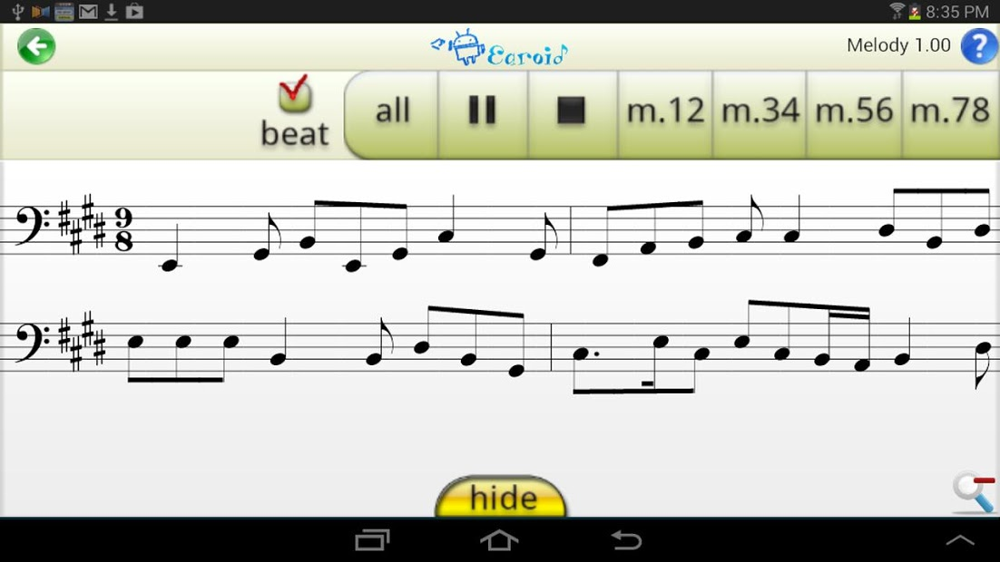
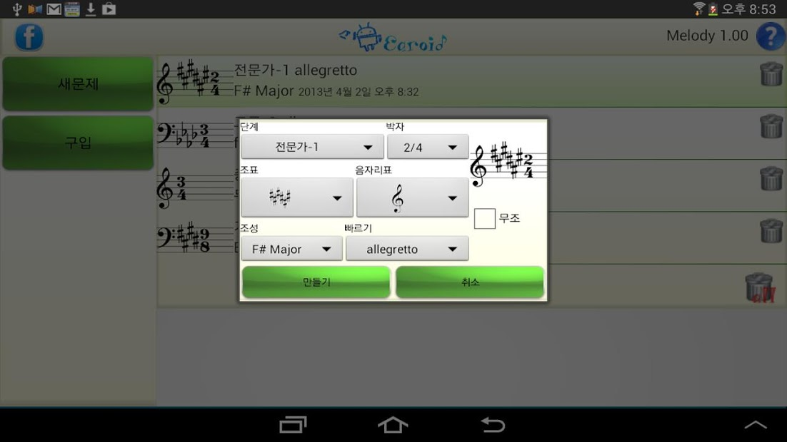
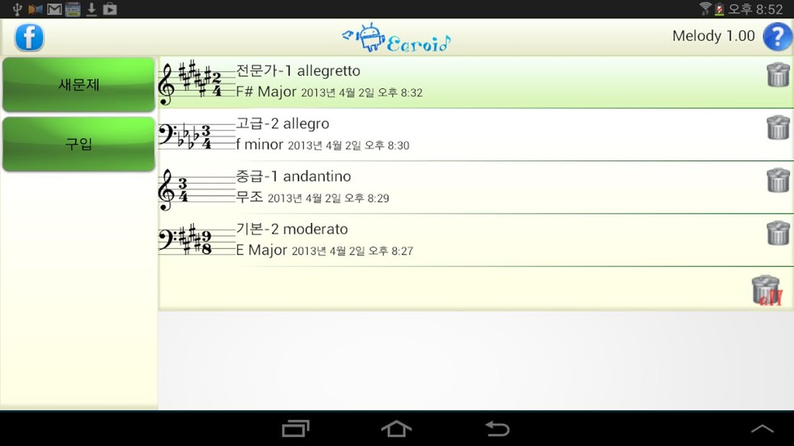

# Earoid

An Android ear-training app that generates musical exercises, plays them back, and reveals the score for checking your answer.

[Project document](Document/earoid.pdf) · [Original Google Play listing](https://play.google.com/store/apps/details?id=com.sempre.earoidm)

*The original application: listen to a melody, repeat a passage, then reveal the notation.*

## The practice loop

1. **Create an exercise.** Choose difficulty, meter, key, clef and tempo, with tonal and atonal options.
2. **Listen and repeat.** Play the complete exercise or a pair of measures, with count-in and repeat controls.
3. **Check the score.** Reveal the notation and revisit exercises from the saved library.

| Exercise settings | Saved exercises |
| --- | --- |
|  |  |

## Inside the source

| Component | Responsibility |
| --- | --- |
| [MakeMelody](MakeMelody/) · [Harmonic](Harmonic/) | Tonal and serial melody generation, harmonic progressions and non-harmonic tones |
| [MakeRhythm2](MakeRhythm2/) | Rhythmic units and exercise construction |
| [musicXML](musicXML/) · [ScoreComponent](ScoreComponent/) | Score data, MusicXML handling and notation rendering |
| [WaveProcessing](WaveProcessing/) · [ExamScreen](ExamScreen/) | Audio creation, playback, score display and exercise controls |
| [MainScreen](MainScreen/) · [ExampleDB](ExampleDB/) | Exercise creation, library UI and local storage |

Start with [MainActivity.java](com/sempre/earoidm/MainActivity.java) for exercise creation and [ExampleActivity.java](com/sempre/earoidm/ExampleActivity.java) for playback and score interaction.

## Repository status

This repository preserves the original Java source, application screenshots and project document. It does not contain an Android manifest, resource bundle or Gradle build configuration, so it is a source archive rather than a complete Android Studio project. The original Android resources, audio assets and native decoder integration would be needed to rebuild the application.

## License

[GNU General Public License v3.0](LICENSE).

Full project notes

<!-- preserved-project-notes:start -->
# earoid-app
ear-training app for android

https://play.google.com/store/apps/details?id=com.sempre.earoidm

<!-- preserved-project-notes:end -->

